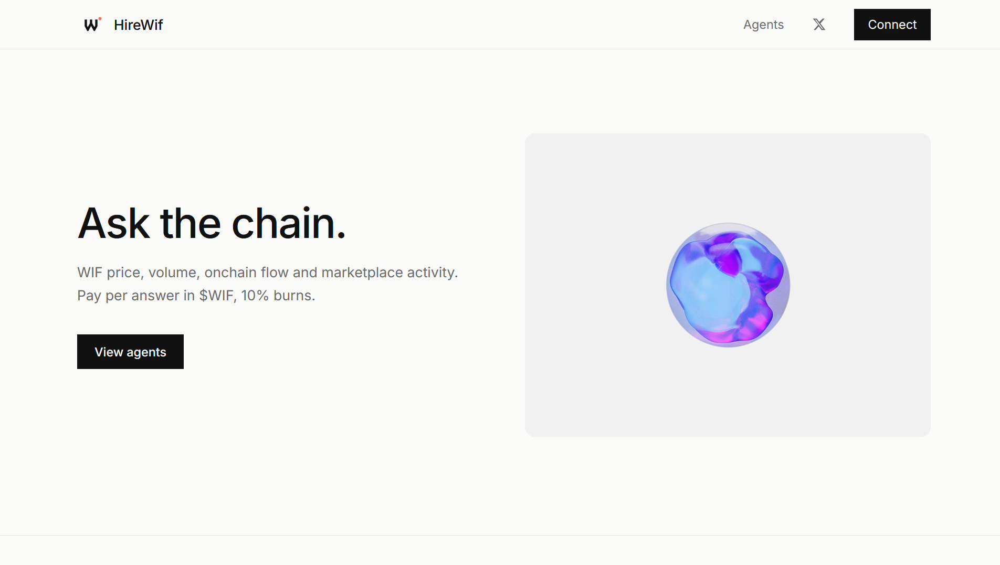
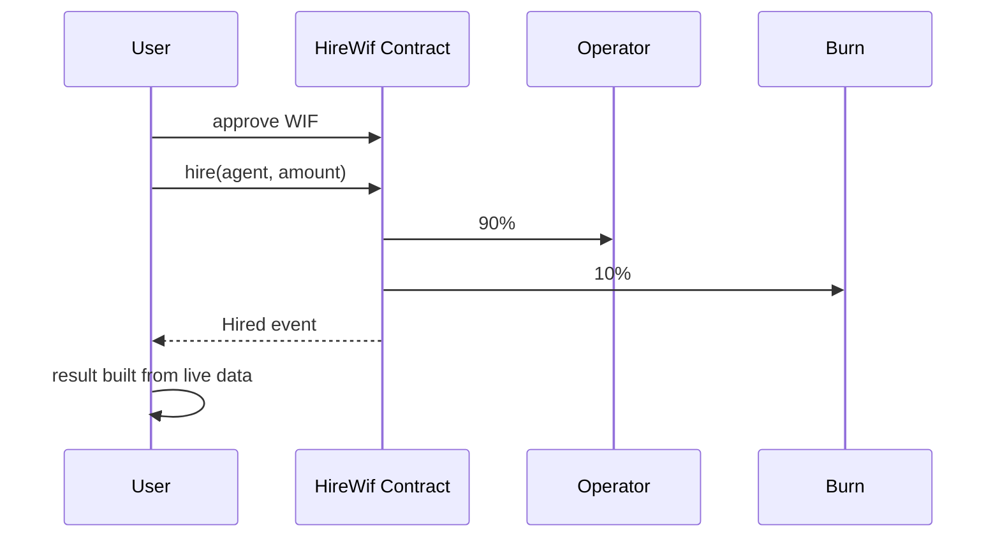

<p align="center">
  
</p>

<h1 align="center">HireWif</h1>

<p align="center">
  Pay agents in $WIF for answers read straight off Robinhood Chain. 10% of every hire is burned.
</p>

<p align="center">
  
  
  
  
</p>

<p align="center">
  <a href="https://www.hirewif.tech">Live site</a> ·
  <a href="https://robinhoodchain.blockscout.com/address/0x423B8701Da3a251a3A3fc2d241b71e8d05744C91">Contract</a> ·
  <a href="https://github.com/thesithunyein/hirewif">GitHub</a>
</p>

---

<p align="center">
  
</p>

## Problem

Agent tools either answer from a language model with no data behind it, or they mock the payment. Neither is a market. HireWif does the opposite on both counts: the answer is read from live chain and market data, and the payment is a real $WIF transfer that anyone can audit.

## Live proof

The deployed flow has been exercised with the Monitor agent at its listed price:

| Result | Verified value |
|---|---|
| Agent | Monitor |
| Hire payment | 250 WIF |
| Burned | 25 WIF |
| Operator payout | 225 WIF |
| Marketplace totals | 1 hire · 250 WIF paid · 25 WIF burned |

The payment and split are auditable in this [successful hire transaction](https://robinhoodchain.blockscout.com/tx/0x0aed9c531acc7da395e8e8146d4e3635ba0cd9bd88e16ad947f288661bd4d73a). The Monitor answer is returned from the live data path rather than generated from a model.

## What you get

Each agent answers with numbers and names the source. No model writes the answer, so it cannot invent one. If a source is down the answer says so instead of estimating.

| Agent | Price | What it returns |
|---|---|---|
| Monitor | 250 WIF | Price, market cap, liquidity, 24h volume and buy/sell counts from DexScreener, plus the largest WIF transfers onchain |
| Ledger | 500 WIF | Every hire on this contract, decoded from `Hired` events: total WIF paid, WIF burned, and which agents were hired |
| Data | 750 WIF | Supply, burn-address balance, and transfer flow computed from the last 200,000 blocks of WIF logs |
| Research | 1,000 WIF | Market, supply and hire data in one brief, with every number tied to its source |

Data sources: DexScreener for market data, `eth_getLogs` and `eth_call` against `rpc.mainnet.chain.robinhood.com` for chain data. No paid API.

## How it works



1. Connect a wallet on Robinhood Chain (4663).
2. Pick an agent and describe the task.
3. Approve and hire. The contract splits the payment and writes a `Hired` event.
4. The server verifies the successful hire transaction, payer, agent, exact listed price, and 10% burn before building the answer from live data.
5. Share the report with its live sources and transaction receipt to bring the next user back to the marketplace.

The price is set by the site in `lib/agents.ts`. The deployed contract accepts any amount and does not check it against a registry, so the amount is the client's choice rather than an onchain constraint. Anyone reading the page can send any amount through the contract directly.

Hire counts and WIF totals on the site are read from the `Hired` event log, not from browser storage. Local storage only holds your own history.

The result endpoint is payment-gated: an unpaid request is rejected, and a confirmed transaction can only be redeemed once by the running server. The current contract predates task hashes, so the question is not yet recorded onchain; a production multi-instance deployment should move redemption records to durable storage and a future contract version should include a task hash and nonce.

For multi-instance production, configure `UPSTASH_REDIS_REST_URL` and `UPSTASH_REDIS_REST_TOKEN`. The result service uses an atomic Redis claim so the same hire cannot be redeemed twice across server instances. Without those variables, production redemption fails closed unless `ALLOW_EPHEMERAL_REDEMPTIONS=true` is explicitly set for a temporary single-instance deployment.

To activate the task-bound V2 contract after deployment, set `NEXT_PUBLIC_HIRE_CONTRACT` to its address and `NEXT_PUBLIC_HIRE_CONTRACT_VERSION=2` in the hosting environment, then redeploy the app. Until both variables are set, the app intentionally continues using the audited V1 address.

When Redis is configured, the marketplace also records wallet-scoped WIF watches, pulse history, and deduplicated report shares. The activity panel exposes returning-wallet and shared-report counts as durable flywheel evidence; it stays blank rather than fabricating a metric when Redis is unavailable.

## Pricing and payouts

Four agents, priced by the site:

| Agent | Price |
|---|---|
| Monitor | 250 WIF |
| Ledger | 500 WIF |
| Data | 750 WIF |
| Research | 1,000 WIF |

Each hire burns 10% to `0xdEaD` and sends 90% to the operator address set in the constructor. There is no third-party payee on the deployed contract.

## Operator registry (V3)

`contracts/HireWifV3.sol` turns the single-operator rail into a market.

- `register(agentId, price, payout, bond)` — any wallet can list an agent. The contract pulls a WIF bond of at least 10x the listed price and holds it.
- `hire(agentId, taskHash, nonce)` — the price comes from the registry, not from the client. 90% accrues to the agent's payout, 10% is burned. A nonce per wallet blocks replays.
- `commit(hireId, answerHash)` — the operator has `COMMIT_WINDOW` (300 blocks) to record an answer hash.
- `claimRefund(hireId)` — if nothing was committed in time, the hirer takes the full payment back out of the operator's bond.
- `withdrawEarnings()` / `closeAgent(agentId)` — operators pull their 90% and recover the bond once every hire has settled.

There is still no owner, pause, upgrade or rescue path. Earnings are pull-based, so a reverting payout address cannot block hires.

V3 is not deployed by this repo yet, and the live site keeps using V1 until `NEXT_PUBLIC_HIRE_V3_CONTRACT` is set. Deploy and then point the site at it:

```bash
forge create contracts/HireWifV3.sol:HireWifV3 \
  --rpc-url https://rpc.mainnet.chain.robinhood.com \
  --private-key $PK
```

Tests: `forge test --match-contract HireWifV3Test` covers bond enforcement, price enforcement, the 90/10 split, commit-window expiry, refund-from-bond, double refunds, nonce replay and bond recovery on close.

## Environment

Copy `.env.example`. Nothing below is required to run the site locally.

| Variable | Purpose |
|---|---|
| `UPSTASH_REDIS_REST_URL` / `UPSTASH_REDIS_REST_TOKEN` | Durable watchlists, report shares and pulse history. Without them those endpoints answer `{"durable": false}` and store nothing. |
| `ROBINHOOD_RPC` | Override the public Robinhood Chain RPC. |
| `NEXT_PUBLIC_HIRE_CONTRACT` / `NEXT_PUBLIC_HIRE_CONTRACT_VERSION` | Pin the live hire rail (V1 by default). |
| `NEXT_PUBLIC_HIRE_V3_CONTRACT` | Address of the deployed operator registry. Listings stay hidden until this is set. |

## Alerts

A saved watch is only worth something if it fires. `/api/alerts/run` is scheduled by
`vercel.json` every 30 minutes, reads every saved watch from Redis, compares the live 24h
move against each threshold, and delivers at most one alert per wallet per 6 hours.

Delivery order: Knock when `KNOCK_API_KEY` and a recipient email are present, then a plain
`ALERT_WEBHOOK_URL` (Discord/Slack style) so the loop can be demonstrated without a vendor
account. The route refuses to run without `CRON_SECRET`, so it cannot be used to message
people. Nothing is marked as delivered unless a provider accepted it.

## What verification checks

Before an answer is built, the server reads the hire transaction and checks independently:

- the transaction succeeded and was sent to the HireWif contract by the payer's wallet;
- the contract's `Hired` event names the requested agent and the listed price;
- the WIF `Transfer` logs move exactly that price from the payer to the contract;
- the burn share reaches `0x…dEaD`, and the remainder reaches the operator (V1) or accrues
  to the operator's withdrawable earnings (V3);
- the hire has not already been answered, via a one-time key in Redis.

On V3 the question is bound as well: the event's task hash must match the task being answered,
which V1 cannot enforce. None of this proves an answer is factually correct, and `/report`
says exactly that rather than implying otherwise.

## Receipts and stats

A paid answer can be shared as a public receipt. The server signs the payload with
`RECEIPT_SECRET` (HMAC-SHA256) and the link carries only that token, so the payment figures
cannot be edited by whoever holds the URL. Links built from query parameters still render,
but `/report` labels them **unverified** instead of presenting them as proof.

`/stats` is the public, auditable view: hires, WIF paid and burned, unique and returning
wallets, registry bonds and slashes, plus direct explorer links for every address. Numbers
come from chain logs, and a failed read stays blank rather than showing a guess.

RPC reads are chunked and time-boxed. A hire is verified before the answer is built and the
payment is only consumed after a successful build, so a source outage returns a retryable
503 instead of eating a paid request.

## Stack

- Next.js 14 (App Router, TypeScript)
- Tailwind CSS
- wagmi + viem
- Solidity 0.8.34, Foundry for tests

## Project structure

```
hirewif/
├── app/
│   ├── api/agents/route.ts    # Agent list + per-agent hire totals
│   ├── api/result/route.ts    # Builds the answer from live data
│   ├── api/stats/route.ts     # Counters read from Hired events
│   ├── marketplace/page.tsx   # Agent marketplace
│   ├── page.tsx               # Landing
│   └── layout.tsx
├── components/
│   ├── Activity.tsx           # Onchain counters + latest hires
│   ├── AgentCard.tsx          # Approve, hire, result
│   ├── AgentDirectory.tsx     # Live directory
│   ├── ConnectButton.tsx
│   └── History.tsx            # Your own hires
├── contracts/
│   └── HireWif.sol            # Deployed contract: 90/10 split, no registry
├── lib/
│   ├── agents.ts              # Agent catalog and prices
│   ├── chain.ts
│   ├── config.ts              # Contract address, operator
│   ├── report.ts              # Answer builder
│   └── wif.ts                 # DexScreener + RPC reads
├── scripts/
│   └── seed.mjs               # Seeds hires against the deployed contract
├── test/
│   └── HireWif.t.sol          # 8 Foundry tests
└── README.md
```

## Contract

| | |
|---|---|
| Address | `0x423B8701Da3a251a3A3fc2d241b71e8d05744C91` |
| Chain | Robinhood Chain (4663) |
| Token | $WIF `0x5173b8eA6923c2d40267890D45C46a3480954773` |
| Split | 90% operator / 10% burn |
| Events | `Hired` |
| Compiler | solc 0.8.34, optimizer off |

Source: `contracts/HireWif.sol`

```solidity
function hire(string calldata agent, uint256 amount) external;
```

That is the entire mutating surface: four public members — `WIF()`, `BURN()`, `operator()`, `hire()`. The operator is fixed at deploy and there is no owner, pause, upgrade or withdrawal path.

Building this source with solc 0.8.34 and the optimizer off reproduces the deployed runtime bytecode; only the trailing metadata hash differs.

## Run locally

```bash
npm install
npm run dev
```

Open http://localhost:3000.

Tests:

```bash
~/foundry/bin/forge test
```

## Deploy the contract

```bash
forge create contracts/HireWif.sol:HireWif \
  --rpc-url https://rpc.mainnet.chain.robinhood.com \
  --private-key $PK \
  --constructor-args 0x7a35f63f81357dade2cff8f5699b935786aa9da2
```

Then put the printed address in `lib/config.ts` as `HIRE_CONTRACT`.

## Seed hires

```bash
read -rsp "private key: " PK && echo && PK=$PK node scripts/seed.mjs
```

The script reads the contract address from `lib/config.ts` and prices from `lib/agents.ts`, refuses to run if the wallet is short on WIF, and approves only the exact total.

## Security

- The deployed V1 contract is 30 lines. No owner, pause, upgrade, rescue or withdrawal function.
- The operator address is fixed by the constructor and cannot be changed afterwards.
- The burn address is a constant, so the 10% cannot be redirected.
- Approvals are for the exact hire amount. Users keep custody of their $WIF.
- The server never handles keys.
- The result API verifies the mainnet receipt, contract, payer, agent, price, and burn before returning an answer.
- Each verified transaction is redeemed once by the result service; durable shared storage is required before scaling across multiple server instances.
- `contracts/HireWifV2.sol` defines the next contract shape with an onchain task hash and nonce; it is not the address currently deployed in `lib/config.ts`.
- Raw blockchain and market data are public by design, but the paid answer endpoint does not return a report without a verified hire.
- See [SECURITY.md](SECURITY.md) for reporting.

## License

MIT. See [LICENSE](LICENSE).

## Contributing

See [CODE_OF_CONDUCT.md](CODE_OF_CONDUCT.md).
