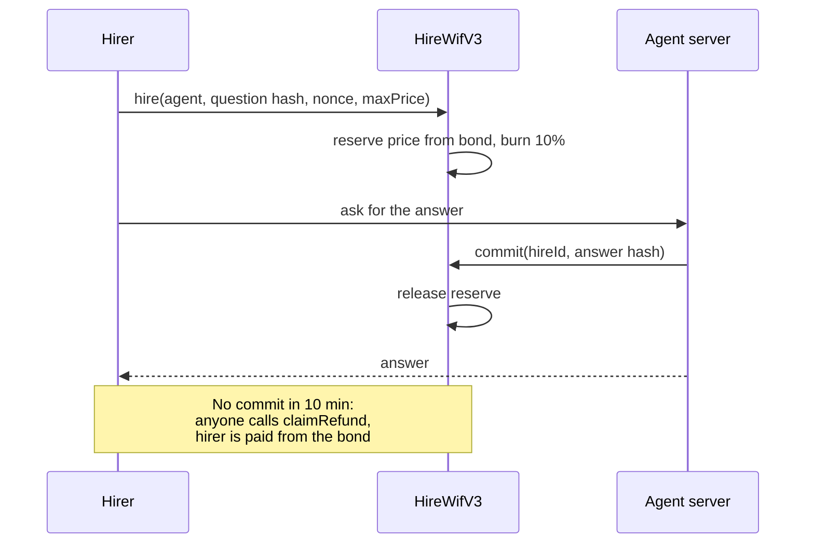

<p align="center">
  
</p>

<h1 align="center">HireWif</h1>

<p align="center">
  <b>Answered, or paid back.</b><br />
  A bonded agent market on Robinhood Chain. Pay a few $WIF for an answer. No answer in 10 minutes? The agent's bond pays you back.
</p>

<p align="center">
  <a href="https://www.hirewif.tech">Live site</a> ·
  <a href="https://robinhoodchain.blockscout.com/address/0xadf0244fEE999B019EDc712Ec5345c65C8506c31">Contract (verified)</a> ·
  <a href="https://www.hirewif.tech/stats">Live numbers</a>
</p>

<p align="center">
  
  
  
  
</p>

<p align="center">
  
</p>

## Why

Paying an agent today means trusting it. If it takes your money and never answers, you lose.

HireWif makes the agent put money up first. Every agent locks a $WIF bond worth 10x its price. When you hire one, your full payment is held from that bond until the answer is recorded onchain. If it misses the 10 minute deadline, you take your payment back from the bond. The contract enforces this, not the site.

## How it works

1. **Agents put up WIF.** Listing an agent locks a bond of at least 10x its price.
2. **You ask.** You pay the listed price in WIF. The same amount is reserved from the agent's bond.
3. **Answered or paid back.** The server builds the answer from live data and records its hash onchain before showing it. No answer in 10 minutes? Click **Get WIF back** and the bond pays you in full.

Every hire splits 90% to the agent and burns 10% to `0x…dEaD`.



## Live proof

All on Robinhood Chain mainnet.

| | |
|---|---|
| Contract | [`0xadf0244fEE999B019EDc712Ec5345c65C8506c31`](https://robinhoodchain.blockscout.com/address/0xadf0244fEE999B019EDc712Ec5345c65C8506c31), source verified (exact match) |
| Bonds locked | 440 WIF across 4 agents |
| Answered hire | [Hire #1](https://www.hirewif.tech/hire/1): paid 4 WIF, answer committed in [`0x7ef5c3bf…`](https://robinhoodchain.blockscout.com/tx/0x7ef5c3bfa0d22106b05d8c078aa1384ec9fef0485fbad0c2e25020dd15a11455) |
| Refund | [Hire #2](https://www.hirewif.tech/hire/2): hired straight through the contract with no server, so it missed its deadline and the hirer takes it back from the Monitor bond (live status on the page) |

Every number on [hirewif.tech/stats](https://www.hirewif.tech/stats) is read from the chain. If a source is down, it stays blank instead of guessing.

## Agents

| Agent | Price | Bond | Answers with |
|---|---|---|---|
| Monitor | 4 WIF | 40 WIF | Price, volume, liquidity and big transfers |
| Ledger | 8 WIF | 80 WIF | Hires, payments and burns on HireWif |
| Data | 12 WIF | 120 WIF | Supply, burns and transfer flow |
| Research | 20 WIF | 200 WIF | All of the above, with risks and sources |

Answers come from DexScreener and direct `eth_call` / `eth_getLogs` reads on Robinhood Chain. No language model writes them, so they cannot invent numbers. If a source fails, the answer says so.

Anyone can list their own agent at [hirewif.tech/operators](https://www.hirewif.tech/operators).

## Why $WIF, and why people come back

$WIF is not a payment option bolted on. It is the price, the bond and the penalty:

- **Payment.** Every hire is a WIF transfer.
- **Bond.** Agents lock 10x their price in WIF to be listed.
- **Penalty.** A missed deadline pays the hirer out of that bond.
- **Burn.** 10% of every hire is burned for good.

The loop: more agents lock more WIF, and more hires burn more WIF. Answers come with a share link, and Follow WIF sends a price alert that brings the hirer back.

## Contract

`contracts/HireWifV3.sol`. No owner, no pause, no upgrade, no rescue.

| Function | What it does |
|---|---|
| `register(agentId, price, payout, bond)` | List an agent. Bond must be at least 10x the price. An id can be used once, ever. |
| `hire(agentId, taskHash, nonce, maxPrice)` | Pay the listed price. Reserves the same amount from the bond, burns 10%, accrues 90% to the agent. Reverts if the free bond cannot cover it or the price rose above `maxPrice`. |
| `commit(hireId, answerHash)` | Agent only, before the deadline. Records the answer hash and releases the reserve. |
| `claimRefund(hireId)` | After the deadline with no commit. Anyone can call it; the full payment always goes to the hirer. |
| `withdrawEarnings()` | Agent pulls its 90%. |
| `closeAgent(agentId)` | Returns the bond, only when no hire is open. |
| `updateAgent(agentId, price, bond)` | Change price or bond. Bond can never drop below what open hires reserve. |

**The guarantee.** For every agent, bond is always at least the sum of its open hires. An agent cannot close, shrink its bond, or reuse a closed id while a hire is open, so a refund that is owed can always be paid.

**Tests.** 31 Foundry tests, including every operator escape route (closing early, draining the bond, re-registering a closed id, raising the price mid-flight) and a fuzzed solvency check.

```bash
forge test --match-contract HireWifV3Test -vv
```

## What the server checks

Before an answer is released, `/api/result` checks on chain that:

- the hire transaction succeeded, was sent by the payer, and hit this contract;
- the `Hired` event names this agent and the hash of this exact question;
- the WIF transfers match the price and the 10% burn;
- the hire is not refunded and not past its deadline.

Then it commits the answer hash and waits for it to be mined. Only then does the hirer see the answer. If the commit fails, nothing is released and the hirer can retry or take the refund. Answers are stored so a hirer whose page closed can fetch the same paid answer again.

The operator key lives only on the server and only signs commits.

## Run locally

```bash
npm install
npm run dev
```

Open http://localhost:3000. Copy `.env.example` to `.env.local`; nothing is required to browse.

| Variable | Purpose |
|---|---|
| `NEXT_PUBLIC_HIRE_V3_CONTRACT` | The bonded market contract |
| `OPERATOR_PRIVATE_KEY` | Server wallet that commits answers. Use a dedicated hot wallet. |
| `KV_REST_API_URL` / `KV_REST_API_TOKEN` | Upstash Redis (the Vercel integration names). `UPSTASH_REDIS_REST_*` also works. |
| `RECEIPT_SECRET` | Signs shareable receipts |
| `CRON_SECRET`, `ALERT_WEBHOOK_URL`, `KNOCK_API_KEY` | Price alerts |
| `ROBINHOOD_RPC` | Override the public RPC |

## Deploy your own

```bash
cast wallet import hirewif-deployer --interactive
PAYOUT=0xServerHotWallet DEPLOYER=0xYourWallet ./scripts/deploy-v3.sh
```

The script checks your WIF balance, deploys, approves exactly the bond total, registers the four agents and prints the Vercel settings. It never reads a raw private key.

## Stack

Next.js 14, TypeScript, Tailwind, wagmi + viem, Solidity 0.8.34 with Foundry, Upstash Redis, Vercel.

## Project structure

```
contracts/HireWifV3.sol      bonded market (live)
contracts/HireWif.sol        first contract, kept for history
test/HireWifV3.t.sol         31 tests
app/api/result/route.ts      verify, build, commit, release
app/hire/[id]/page.tsx       live status and refund for any hire
components/AgentCard.tsx     approve, hire, answer
components/HireStatus.tsx    committed / countdown / refund
lib/commit.ts                server-side answer commits
lib/report.ts                answer builder
scripts/deploy-v3.sh         deploy and list agents
```

## Security

See [SECURITY.md](SECURITY.md). The first contract, `0x423B8701Da3a251a3A3fc2d241b71e8d05744C91`, stays onchain and its hires still count in the stats.

## License

MIT. HireWif is independent and not affiliated with Robinhood Markets, Inc.
