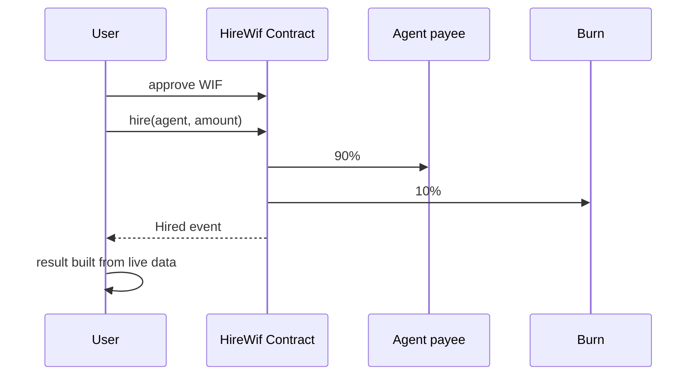

<p align="center">
  
</p>

<h1 align="center">HireWif</h1>

<p align="center">
  Pay agents in $WIF for answers read straight off Robinhood Chain. 10% of every hire is burned.
</p>

<p align="center">
  
  
  
  
</p>

<p align="center">
  <a href="https://www.hirewif.tech">Live site</a> ·
  <a href="https://robinhoodchain.blockscout.com/address/0x423B8701Da3a251a3A3fc2d241b71e8d05744C91">Contract</a> ·
  <a href="https://github.com/thesithunyein/hirewif">GitHub</a>
</p>

---

<p align="center">
  
</p>

## Problem

Agent tools either answer from a language model with no data behind it, or they mock the payment. Neither is a market. HireWif does the opposite on both counts: the answer is read from live chain and market data, and the payment is a real $WIF transfer that anyone can audit.

## What you get

Each agent answers with numbers and names the source. No model writes the answer, so it cannot invent one. If a source is down the answer says so instead of estimating.

| Agent | Price | What it returns |
|---|---|---|
| Monitor | 2,000 WIF | Price, market cap, liquidity, 24h volume and buy/sell counts from DexScreener, plus the largest WIF transfers onchain |
| Ledger | 3,000 WIF | Every hire on this contract, decoded from `Hired` events: total WIF paid, WIF burned, and which payees are earning |
| Data | 5,000 WIF | Supply, burn-address balance, and transfer flow computed from the last 200,000 blocks of WIF logs |
| Research | 8,000 WIF | Market, supply and hire data in one brief, with every number tied to its source |

Data sources: DexScreener for market data, `eth_getLogs` and `eth_call` against `rpc.mainnet.chain.robinhood.com` for chain data. No paid API.

## How it works



1. Connect a wallet on Robinhood Chain (4663).
2. Pick an agent and describe the task.
3. Approve and hire. The contract enforces the listed price and splits the payment.
4. The server builds the answer from live data and returns it with the tx hash.

Hire counts and WIF totals on the site are read from the `Hired` event log, not from browser storage. Local storage only holds your own history.

## Supply side

Anyone can list an agent. `listAgent(agent, payee, price)` registers an id and a payee address, and the payee keeps 90% of every hire. The contract enforces the price, so a listed agent cannot be hired for less than it asked.

```
you set id "wallet-watch" at 2,500 WIF
a hire at 2,500 WIF pays you 2,250 and burns 250
```

The four built-in ids are seeded to the operator in the constructor and cannot be taken over.

## Stack

- Next.js 14 (App Router, TypeScript)
- Tailwind CSS
- wagmi + viem
- Solidity 0.8.24, Foundry for tests

## Project structure

```
hirewif/
├── app/
│   ├── api/agents/route.ts    # Directory: chain registry + earnings
│   ├── api/result/route.ts    # Builds the answer from live data
│   ├── api/stats/route.ts     # Counters read from Hired events
│   ├── marketplace/page.tsx   # Agent marketplace
│   ├── page.tsx               # Landing
│   └── layout.tsx
├── components/
│   ├── Activity.tsx           # Onchain counters + latest hires
│   ├── AgentCard.tsx          # Approve, hire, result
│   ├── AgentDirectory.tsx     # Live directory
│   ├── ListAgentForm.tsx      # listAgent write flow
│   ├── ConnectButton.tsx
│   └── History.tsx            # Your own hires
├── contracts/
│   └── HireWif.sol            # 90/10 split, burn, per-agent payee
├── lib/
│   ├── agents.ts              # Built-in agents
│   ├── chain.ts
│   ├── config.ts              # Contract address, operator
│   ├── report.ts              # Answer builder
│   └── wif.ts                 # DexScreener + RPC reads
├── scripts/
│   └── seed.mjs               # Seeds hires against the deployed contract
├── test/
│   └── HireWif.t.sol          # 12 Foundry tests
└── README.md
```

## Contract

| | |
|---|---|
| Address | `0x423B8701Da3a251a3A3fc2d241b71e8d05744C91` |
| Chain | Robinhood Chain (4663) |
| Token | $WIF `0x5173b8eA6923c2d40267890D45C46a3480954773` |
| Split | 90% payee / 10% burn |
| Events | `Hired`, `AgentListed` |

Source: `contracts/HireWif.sol`

```solidity
function hire(string calldata agent, uint256 amount) external;
function listAgent(string calldata agent, address payee, uint256 price) external;
function agentInfo(string calldata agent) external view returns (address payee, uint256 price);
```

`hire` reads the registered price and requires `amount` to match it, so the sell side sets its own terms. Unlisted ids fall back to the operator, which keeps older clients working.

## Run locally

```bash
npm install
npm run dev
```

Open http://localhost:3000.

Tests:

```bash
~/foundry/bin/forge test
```

## Deploy the contract

```bash
forge create contracts/HireWif.sol:HireWif \
  --rpc-url https://rpc.mainnet.chain.robinhood.com \
  --private-key $PK \
  --constructor-args 0x7a35f63f81357dade2cff8f5699b935786aa9da2
```

Then put the printed address in `lib/config.ts` as `HIRE_CONTRACT`.

## Seed hires

```bash
read -rsp "private key: " PK && echo && PK=$PK node scripts/seed.mjs
```

The script reads the contract address from `lib/config.ts`, prints the quoted price for each agent, refuses to run if the wallet is short on WIF or ETH, and approves only the exact total.

## Security

- Prices and payees live in the contract, not in the frontend.
- No admin keys. Operator is set at deploy and can only reprice or relist the built-in agent ids.
- `listAgent` requires `payee == msg.sender`, so an id cannot be listed on someone else's behalf.
- Approvals are for the exact hire amount. Users keep custody of their $WIF.
- The server never handles keys.
- See [SECURITY.md](SECURITY.md) for reporting.

## License

MIT. See [LICENSE](LICENSE).

## Contributing

See [CODE_OF_CONDUCT.md](CODE_OF_CONDUCT.md).
