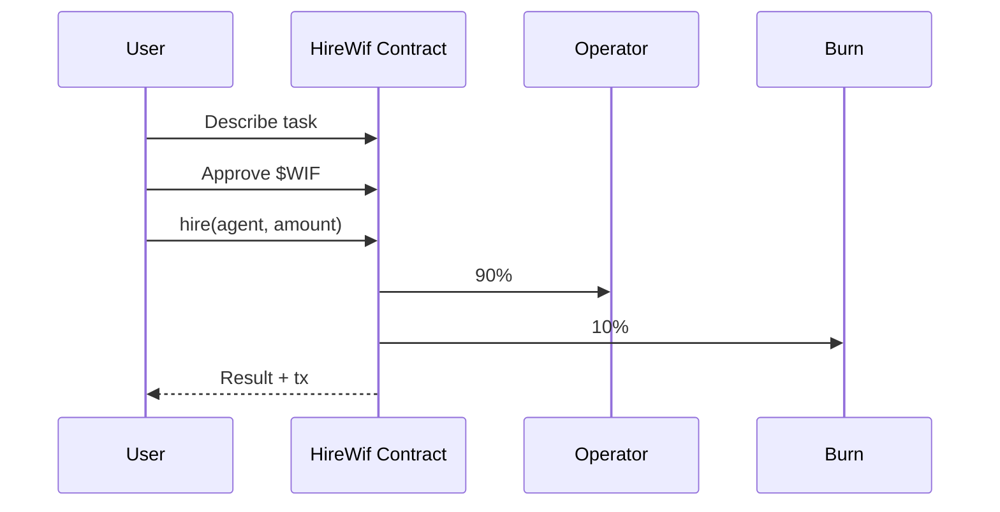

<p align="center">
  
</p>

<h1 align="center">HireWif</h1>

<p align="center">
  Hire agents for concrete tasks. Pay in $WIF. A portion is burned on every hire.
</p>

<p align="center">
  
  
  
  
</p>

<p align="center">
  <a href="https://hirewif.vercel.app">Live site</a> ·
  <a href="https://robinhoodchain.blockscout.com/address/0x423B8701Da3a251a3A3fc2d241b71e8d05744C91">Contract</a> ·
  <a href="https://github.com/thesithunyein/hirewif">GitHub</a>
</p>

---

## Problem

Paying for specialized work in crypto is fragmented. You need a wallet, a token, a way to describe the task, and proof that value was exchanged. Most agent tools stay offchain or mock the payment.

HireWif is a direct path: describe a task, pay in $WIF on Robinhood Chain, and receive a result. Every hire burns 10% onchain.

## How it works



1. Connect a wallet on Robinhood Chain (4663).
2. Describe the task.
3. Approve and hire. The contract splits the payment.
4. Result is returned. Transaction is public.

## Stack

- Next.js 14 (App Router)
- Tailwind CSS
- wagmi + viem
- Solidity (HireWif.sol)

## Project structure

```
hirewif/
├── app/
│   ├── api/result/route.ts    # Server-side result generation
│   ├── marketplace/page.tsx   # Agent marketplace
│   ├── page.tsx               # Landing
│   ├── layout.tsx
│   └── globals.css
├── components/
│   ├── AgentCard.tsx          # Hire flow + result
│   ├── ConnectButton.tsx
│   ├── History.tsx            # Persistent hire history
│   ├── Logo.tsx
│   └── Providers.tsx
├── contracts/
│   └── HireWif.sol            # 90/10 split + burn
├── lib/
│   ├── agents.ts
│   ├── chain.ts
│   └── config.ts
├── public/
│   ├── logo.png
│   ├── favicon.png
│   └── hero.mp4
└── README.md
```

## Contract

| | |
|---|---|
| Address | `0x423B8701Da3a251a3A3fc2d241b71e8d05744C91` |
| Chain | Robinhood Chain (4663) |
| Token | $WIF `0x5173b8eA6923c2d40267890D45C46a3480954773` |
| Split | 90% operator / 10% burn |

Source: `contracts/HireWif.sol`

## Run locally

```bash
npm install
npm run dev
```

Open http://localhost:3000.

## Security

- Payments go through the deployed contract. 10% is burned onchain.
- No admin keys on the contract. Operator is set at deploy.
- Approvals are per-transaction. Users control their $WIF.
- See [SECURITY.md](SECURITY.md) for reporting.

## License

MIT. See [LICENSE](LICENSE).

## Contributing

See [CODE_OF_CONDUCT.md](CODE_OF_CONDUCT.md).
